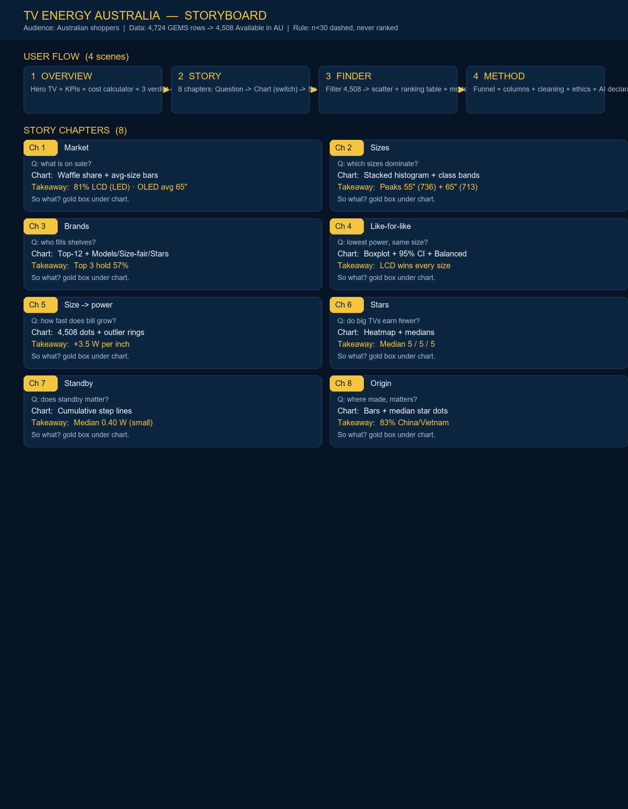

# Appliance Energy Consumption Website

## Project Overview

This project is an interactive website developed for COS30045 Data Visualisation.

The website explores television energy consumption data for television models currently available in the Australian market. It demonstrates the use of HTML, CSS and JavaScript while also presenting data visualisations created from data processed using KNIME.

## Website Features

The website contains four scenes:

### Overview
Hero with a live 3D TV that resizes with the chosen size class, KPI count-ups, an energy-cost calculator (gauge + size presets from real class means) and three evidence flip-cards (size first, brand-then-tech, stars within a size).

### Story
Eight chapters (Market → Sizes → Brands → Like-for-like → Size & power → Stars → Standby → Origin). Each chapter follows Question → Chart (with switches) → So what? Chapter 4 has a Raw/Balanced sampling switch; groups under n=30 are dashed, never ranked.

### Finder
Filter all 4,508 models (size range, technology, brand, stars), rank by leanest/size/watts/stars, click a dot or row for a model detail card with yearly cost at your usage.

### Method
Funnel 4,724 → 4,508, columns used/unused, cleaning steps, size-fair index definition, accuracy/ethics notes.

## Data Story

### Intended Audience

The intended audience is Australian consumers who are comparing televisions and want to better understand the television options available in the market and their energy use.

Consumers may be interested in factors such as screen size, brand, screen technology and electricity consumption when choosing a television.

### Story Structure

The visualisation story begins by showing what television technologies are currently available in Australia (waffle share + average size by tech, which proves raw tech averages mislead).

It then explores the most common screen sizes (stacked histogram with size-class bands) and the brands that have the greatest number of television models (Top-12 with Models / Size-fair / Stars switch).

The story then compares power use of screen technologies at the same size (boxplots with mean ◆, 95% CI ticks and n<30 dashed rule, plus a Raw/Balanced equal-sampling switch), examines size vs power (4,508 dots with rolling medians and IQR-outlier rings) and stars by size class (heatmap with medians).

Two final chapters cover standby power (cumulative share — small effect) and country of manufacture (no buying signal). The page closes with an end verdict (size first, brand-then-tech, stars within a size).

This order was chosen so that the audience first understands the television market before moving into energy-related comparisons that may help inform purchasing decisions.

### Storyboard

The storyboard above plans the user journey: Home (why efficiency matters) > tech pie > size bar >
brand bar > pivot grouped bar > size-power scatter > star scatter > takeaway. Each card on the
Televisions page follows this order so a shopper can go from "what is on the market" to
"what should I buy to save power" in one scroll.

## About the Data

### Data Source

The television dataset is file `tv_2026_02_15.csv` (downloaded 15 Feb 2026, 4,724 rows, 32 columns)
published by the Australian Government via data.gov.au (Energy Rating appliance data).
Column meanings are from the data dictionary `televisionsmay2015(1).docx`.
The dataset is updated regularly, so February and March downloads differ - this project pins the Feb-15 version.

### Data Processing

All cleaning and exploration was done in KNIME Analytics Platform (Local space:
`KNIME-workspace/COS30045 Exercises/`, CSV Reader pointed to `Relative to > Current workflow data area > data/tv_2026_02_15.csv`).

Exercise 1 workflow (Ex1_BrandCount):
- CSV Reader (relative to workflow data area) > Column Filter (keep only Brand_Reg, SoldIn
  and Availability Status, as each row is one TV model)
- Statistics tab check: 96 unique Brand_Reg raw, no missing Brand_Reg. Duplicate Model_No
  values were not explored in this exercise (assumed none, as instructed).
- String Cleaner on Brand_Reg (uppercase + trim): 96 -> 81 unique
- String Replacer (1): SAMSUNG ELECTRONICS -> SAMSUNG (same company, real-world knowledge)
- String Replacer (2): Q.BELL -> QBELL and S VISION -> SVISION (dot/space variants)
- Row Filter: Availability Status = Available only (4,710 rows, 79 brands)
- Rule-based Row Filter: SoldIn LIKE "*Australia*" (remove New Zealand-only / Fiji-only):
  4,508 rows, 74 brands, 4 SoldIn values
  (Australia / Australia,Fiji / Australia,New Zealand / Australia,Fiji,New Zealand)
- GroupBy (group Brand_Reg, aggregation Count on SoldIn) > Sorter (descending count) > Bar/Pie Chart
- CSV Writer (overwrite) -> `BrandCount_clean.csv` for the website (Week 4 D3 build).
  Workflow exported as `.knwf` with data included.

Exercise 2 workflow (Ex2_Exploration):
- Histogram on screensize (bins 10/20/30 tested; bin 20 default hides small peaks at 150-175 cm)
- Expression: `screensize_inch = screensize / 2.54` (double), plus Number To String on the
  inch column so it can be used as a nominal category in the per-size bar chart
- Rule Engine size_category: `small if inch < 43, medium if inch <= 65, else large`
  (means: small 40.7W n=1107, medium 105.5W n=2049, large 196.5W n=1352)
- Scatter Plot: X=screensize_inch, Y=Avg_mode_power (positive relationship)
- GroupBy Screen_Tech (count + mean size: OLED 65.0" > LED 59.5" > LCD 50.6", so direct comparison is confounded)
- Pivot: Groups tab = Screen_Tech, Pivots tab = size_category, Manual Aggregation tab =
  mean of Avg_mode_power -> table of screen tech x size category, then grouped bar chart
- Star2 note: mean suits Labelled kWh / Watts; Star rating is ordinal efficiency index (size-adjusted), compare via median/distribution, not mean Watts.

The cleaned tables (`knime_output/SizeTech_clean.csv` — 18 columns incl. inch, size class,
standby, star index, outlier flag — from Ex2, `knime_output/SizeTech_equal_sampled.csv` —
864 rows balanced per size block, seed 2026 — and `knime_output/BrandCount_clean.csv` from Ex1)
are read directly by the website's `data.js`, which builds the in-browser model table.
The eight story chapters, the finder and the calculator are drawn live with D3.js v7 from
these files, so re-running the KNIME workflows and copying the new CSVs into `knime_output/`
updates the website without touching any code.

## Live data pipeline (KNIME -> CSV -> D3)

1. Execute the KNIME workflow (Ex1_BrandCount or Ex2_Exploration) so all nodes are green.
2. The CSV Writer node writes the fresh table into the workflow's `data/` folder (Overwrite mode).
3. Copy the fresh CSVs into this repo's `knime_output/` folder (same file names).
4. Refresh the website - the D3 charts re-read the CSVs and update automatically.
5. Commit and push so the deployed site (Vercel) shows the new data too.

### Privacy

The dataset contains information about television products rather than personal information about individuals.

Therefore, the visualisations do not use personally identifiable information.

### Accuracy and Limitations

The visualisations are based on `tv_2026_02_15.csv` and depend on the accuracy of the original registrations.
Product availability changes over time; February data differs from March.

Known quirks checked in KNIME: small frequency bumps around 150-175 cm are valid large TVs
(verified Model_No contains 58"/65"/70" etc.), not misclassification, but Histogram bin size can hide/show them.
Some categories are highly imbalanced (e.g., LED 3,658 vs OLED 288; small-OLED n=17), so means for tiny cells
are noisy and should be read with counts shown in the Pivot table.

Some categories contain substantially more television models than others, so comparisons between categories should be interpreted carefully.

The visualisations show relationships within the dataset but do not necessarily demonstrate that one variable causes another.

### Ethics

The visualisations were designed to represent the data accurately and avoid misleading comparisons.

Charts were selected according to the type of data being presented, and labels and supporting explanations were included to help users understand the findings.

The purpose of the visualisations is to help users understand television energy consumption rather than encourage the purchase of a particular brand or product.

## Technologies Used

- **HTML**  
  Used to create the structure and content of the website.

- **CSS**  
  Used to control the layout, colours and visual styling.

- **JavaScript**  
  Used for interactive navigation between the website sections and for drawing
  the live charts.

- **D3.js (v7, vendored in `js/`)**
  Used to read the KNIME-exported CSV files and draw the eight story chapters,
  the finder scatter and all calculator visuals. No internet needed since the library
  file is stored in the repo.

- **KNIME Analytics Platform**  
  Used to clean, transform, aggregate and explore the television dataset.

- **GitHub**  
  Used for version control and storage of the project files.

- **Vercel**  
  Used to deploy and host the website.

## AI Declaration

I used GitHub Copilot in VS Code while building this website. It mostly helped with small
HTML/CSS suggestions and finding typos. I also asked generative AI to explain a few KNIME
errors and to suggest clearer wording for some paragraphs. I checked everything it suggested
and only kept what I understood. I can explain all the code and all the KNIME steps in this
project myself.

## Reflection

Through this task, I improved my understanding of how HTML, CSS and JavaScript work together to create an interactive website.

I also gained experience using GitHub for version control and Vercel for website deployment.

Using KNIME helped me understand how real-world datasets need to be cleaned, transformed and aggregated before they can be visualised.

The data storytelling exercise also helped me understand that charts should not simply display data. They should be organised and supported with text so that an audience can understand the main findings and follow a clear story.